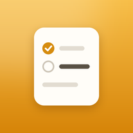
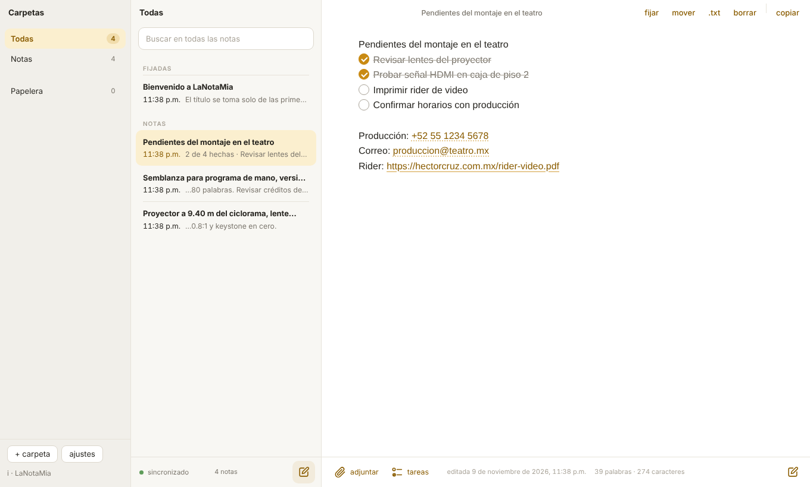
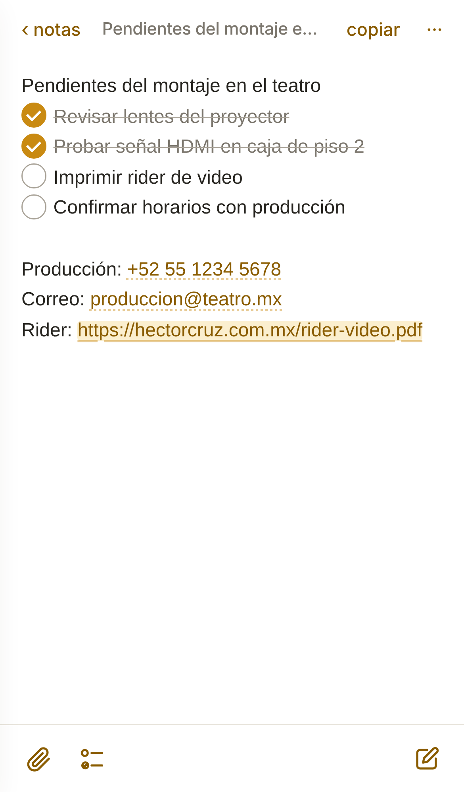
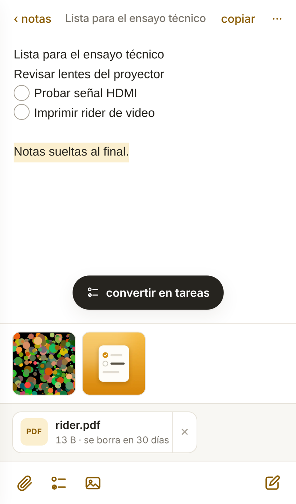
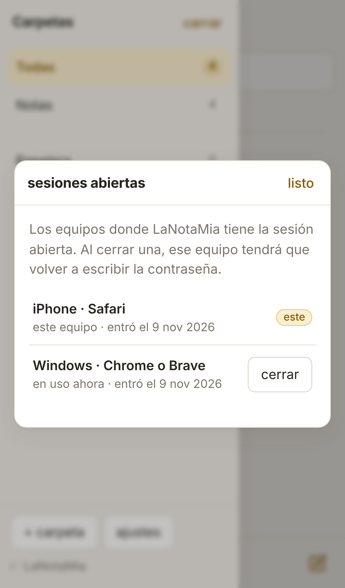
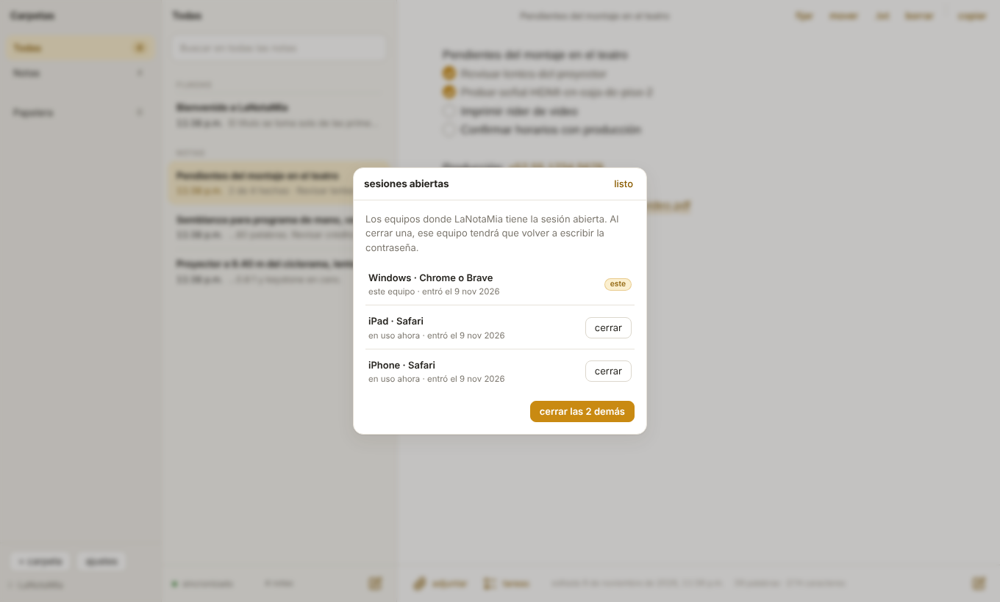

# LaNotaMia

**Versión 0.5** · [Español](#español) · [English](#english)

---

## Español

LaNotaMia es un cuaderno de notas de texto que vive en tu propio servidor. Escribes en el teléfono y la misma nota aparece en la computadora, la tableta o cualquier navegador, con una sola contraseña. Está inspirada en Notas de Apple, pero funciona igual en Windows, Mac, iPhone y Android.

No usa base de datos ni servicios externos: cada nota es un archivo `.json` en tu hosting.

### Qué hace

- **Notas de texto** que se guardan solas mientras escribes y se sincronizan entre equipos.
- **Título automático** a partir de las primeras palabras.
- **Modo lectura**: cuando no estás escribiendo, los enlaces, correos y teléfonos se pueden tocar.
- **Listas de tareas** que se palomean con un toque. Selecciona varias líneas y aparece «convertir en tareas». Se guardan como ☐ / ☑, así que se copian y pegan bien en cualquier lado.
- **Imágenes de referencia** en baja resolución: se reducen en el propio equipo a 800 px y unos 30–90 KB antes de subirse, no caducan y cada equipo las descarga una sola vez.
- **Archivos adjuntos** de hasta 20 MB para pasarlos entre equipos. Se borran solos a los 30 días; la nota se queda.
- **Carpetas, búsqueda, notas fijadas y papelera** (30 días).
- **Funciona sin conexión**: lo que escribes se sube al volver la red. Si editas la misma nota en dos equipos a la vez, nada se pierde: tu versión queda como copia marcada «conflicto».
- **Sesiones abiertas**: en Ajustes ves cada equipo con la sesión abierta y puedes cerrarla en uno o en todos los demás.
- **Se instala como app** en el iPhone, Android, Windows o Mac, y abre al instante.

| Lista de tareas en el iPhone | Seleccionar y convertir en tareas | Sesiones abiertas |
|---|---|---|
|  |  |  |

### Instalar

Necesitas un hosting con **PHP 7.4 o más nuevo** y **https** (el de un sitio WordPress sirve).

1. Copia `config.example.php` como `config.php` y escribe tu **código de instalación** en `LNM_CODIGO_INSTALACION`. Solo se pide una vez, al crear la contraseña, para que nadie más pueda adueñarse de la app si llega antes que tú.
2. Sube la carpeta a tu servidor, por ejemplo a `public_html/lanotamia/`.
3. Abre la dirección en el navegador, escribe el código y crea tu contraseña (mínimo 8 caracteres).
4. La carpeta `data/` se crea sola con permisos privados.

**Recomendado:** pon los datos fuera de la carpeta pública cambiando `LNM_DATA` en `config.php`. En nginx el `.htaccess` no funciona: bloquea `data/` y `config.php` en la configuración del sitio.

**Si olvidas la contraseña:** borra `clave.json` dentro de la carpeta de datos. Las notas no se tocan.

**Respaldo:** copia la carpeta de datos, o usa Ajustes → «descargar todas las notas (.json)».

### En cada equipo

- **iPhone / iPad:** Safari → Compartir → «Agregar a inicio».
- **Android:** Chrome → menú ⋮ → «Instalar app».
- **Windows / Mac:** icono de instalar en la barra de direcciones de Chrome, Edge o Brave.

### Atajos de teclado

| Atajo | Acción |
|---|---|
| Alt + N | Nota nueva |
| Ctrl/Cmd + K | Buscar |
| Ctrl/Cmd + Shift + L | Lista de tareas |
| Ctrl/Cmd + Shift + C | Copiar la nota completa |
| Esc | Volver a lectura / a la lista |

### Seguridad

La contraseña se guarda cifrada (`password_hash`). La sesión es una cookie HttpOnly, Secure y SameSite=Strict. Tras 5 intentos fallidos el servidor hace esperar cada vez más. Las notas **no** van cifradas en el servidor: no guardes ahí contraseñas ni datos bancarios.

---

## English

LaNotaMia is a plain-text notebook that lives on your own server. Write on your phone and the same note shows up on your computer, tablet or any browser, behind a single password. It is inspired by Apple Notes, but works the same on Windows, Mac, iPhone and Android.

No database and no third-party services: each note is a `.json` file on your hosting.

### Features

- **Text notes** that save as you type and sync across devices.
- **Automatic title** from the first words.
- **Reading mode**: when you are not typing, links, email addresses and phone numbers are tappable.
- **Checklists** you tick with one tap. Select several lines and a "convertir en tareas" button appears. Stored as ☐ / ☑, so they copy and paste cleanly anywhere.
- **Low-resolution reference images**: resized on the device to 800 px and about 30–90 KB before upload, they never expire and each device downloads them only once.
- **Attachments** up to 20 MB to move files between devices. They delete themselves after 30 days; the note stays.
- **Folders, search, pinned notes and trash** (30 days).
- **Works offline**: changes upload when the connection returns. If the same note is edited on two devices at once, nothing is lost: your version is kept as a copy marked "conflicto".
- **Open sessions**: Settings lists every device with an open session, and you can sign out one or all the others.
- **Installs as an app** on iPhone, Android, Windows or Mac, and opens instantly.

### Install

You need hosting with **PHP 7.4 or newer** and **https** (a WordPress host works).

1. Copy `config.example.php` to `config.php` and set your **install code** in `LNM_CODIGO_INSTALACION`. It is asked once, when the password is created, so nobody else can claim the app before you.
2. Upload the folder to your server, e.g. `public_html/lanotamia/`.
3. Open the address, enter the code and create your password (8 characters minimum).
4. The `data/` folder is created automatically with private permissions.

**Recommended:** keep the data outside the public folder by changing `LNM_DATA` in `config.php`. On nginx the `.htaccess` file does not apply: block `data/` and `config.php` in the site configuration.

**Forgot the password?** Delete `clave.json` in the data folder. Notes are not touched.

The interface is in Spanish.

---

## Créditos / Credits

Diseño, investigación y desarrollo: Héctor Cruz Juárez — https://hectorcruz.com.mx  
Colección Alchemy of Meaning.

## Licencia / License

GPL-3.0-or-later. Ver / see [LICENSE](LICENSE).
